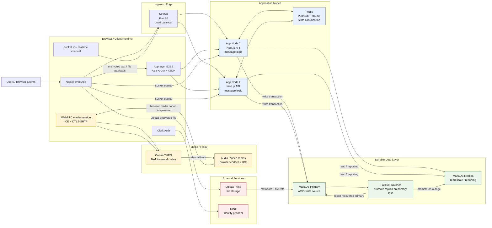

# End-to-End Architecture

This diagram captures the full runtime flow for SyncMove, including user traffic, app services, message delivery, database persistence, media relay, and failover patterns.

## End-to-end flow

1. User opens the Next.js app in the browser.
2. Authentication is provided by Clerk and session identity is established.
3. Browser sends realtime messages and channel actions through NGINX to the app nodes.
4. App nodes coordinate realtime delivery with Redis pub/sub and fan-out logic.
5. Message and file data are persisted in MariaDB primary; reads can be served by the replica.
6. Text and file payloads are compressed and encrypted in the app layer before transport and storage.
7. Audio and video calls use WebRTC transport encryption via DTLS-SRTP, with TURN used as the relay/fallback for NAT traversal.
8. If the primary MariaDB becomes unavailable, the failover watcher promotes the replica. Once the old primary recovers, it rejoins as a replica of the promoted primary.

## Failure and scale considerations

- One app node can fail without taking the whole stack down.
- Primary DB outage blocks writes unless failover promotes the replica.
- Redis is the first major bottleneck under heavy message fan-out.
- TURN is required for peer-to-peer media when direct UDP connectivity is blocked by NAT or firewalls.
- The local stack is sized for staging and bounded developer deployments rather than massive global traffic.
