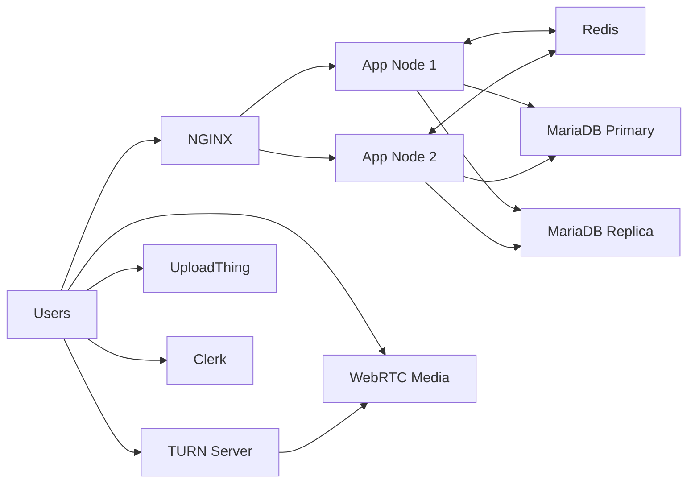

# SyncMove Project Summary

## 1. What this project is

SyncMove is a distributed realtime collaboration app with:

- secure messaging
- server and channel-based structure
- file upload support
- WebRTC call support
- end-to-end encrypted key exchange for secure messaging
- multi-node deployment with NGINX in front of app instances

The app is built with Next.js, Prisma, MariaDB, Redis, Clerk, UploadThing, and Coturn.

## 2. Core architecture

### Frontend / app layer

- Next.js 16 app router
- Clerk handles authentication
- Redis-backed realtime event handling
- Socket.IO for messaging and live updates

### Data layer

- MariaDB as the durable transactional store
- Primary DB for writes
- Replica DB for reads / scaling
- Prisma ORM for schema and query management

### Realtime / communication

- Redis pub/sub for delivery coordination
- Socket.IO for message sync and rooms
- Coturn TURN server for WebRTC NAT traversal / relay fallback

### Security and encryption

- X3DH-based key exchange logic
- signed pre-key verification
- encrypted message handling in the app architecture
- Clerk-managed auth sessions
- current audio/video path uses browser/WebRTC native codec compression and DTLS-SRTP transport encryption
- strict app-level requirement: if media must be encrypted before transport, this repo does not yet implement a custom encrypt-first media pipeline; that would be a different architecture requiring a dedicated media-encryption layer and key distribution flow before raw media leaves the browser

### Compression and encryption by payload type

Text messages:

- UTF-8 text is encoded in the browser
- optional gzip/brotli compression is applied before encryption when supported
- the message payload is then encrypted with AES-GCM using a derived per-session key
- X3DH + double-ratchet keys provide the secure session and message-key lifecycle

Files:

- file bytes are read as a Uint8Array
- gzip compression is applied via the browser CompressionStream API
- a random 256-bit AES-GCM key and 96-bit IV are generated
- the compressed payload is encrypted with AES-GCM
- the file key is then exported or wrapped for recipient delivery
- the server stores the encrypted blob and metadata; decryption reverses the same order: decrypt → decompress → original file

Audio / video:

- browser audio/video capture goes through WebRTC media codecs
- audio uses Opus in the browser by default when supported
- video uses VP8 or H.264 depending on browser and negotiation
- encryption is handled by WebRTC itself with DTLS-SRTP, using ICE/TURN for NAT traversal
- there is no application-level custom compress-then-encrypt pipeline before raw audio/video leaves the browser

This means the app has a clear per-type model:

- text: app-layer compression + app-layer AES-GCM encryption
- files: app-layer compression + app-layer AES-GCM encryption
- live audio/video: browser/WebRTC codec compression + WebRTC transport encryption (DTLS-SRTP)

### Storage

- UploadThing for media/file uploads

## 3. Deployment topology

Current Docker topology:

- NGINX load balancer on port 80
- app-node-1 on port 3001
- app-node-2 on port 3002
- Redis on port 6379
- MariaDB primary on port 3307
- MariaDB replica on port 3308
- TURN on ports 3478 and 5349

This follows a small distributed deployment model designed for local staging or a constrained production-like environment.

## 3.1 End-to-end architecture diagram

See [end-to-end-architecture.md](end-to-end-architecture.md) for the full Mermaid diagram and runtime flow.

## 4. What was validated

### Test validation

Verified with Vitest:

- 3 test files passed
- 14 tests passed
- 0 failed
- exit code 0

Covered checks include:

- multi-node app topology
- primary vs replica DB separation
- ACID-oriented schema constraints
- E2EE signed pre-key validation
- user/bot simulation tests for room traffic, burst loads, and server-capacity assumptions
- explicit audio/video mesh modeling and secure transport checks

### Docker validation

Verified with Compose config validation:

- compose file parsed successfully
- service definitions resolved without syntax errors
- TURN service included in final config

## 5. Results / evidence

### Runtime evidence

The project successfully built during verification:

- Next.js production build completed successfully
- Prisma generated client successfully
- Docker image built successfully for app nodes

### Functional confidence

This gives confidence in:

- schema correctness
- app build path
- multi-node deployment wiring
- encrypted key validation path
- readiness for a local or staging deployment

### Test and simulation metrics

Verified results from the current suite:

- 3 test files passed
- 14 tests passed
- 0 failed

Simulation-based proof points:

- shared room burst: 12 users × 8 messages = 96 unique message events
- room ordering check: 4 users × 25 rounds = 100 messages in one channel
- capacity model: 60 bots + 150 humans = 210 active users within a 2-node topology
- fan-out model: 3 rooms × 7 unique senders = 21 unique fan-out events
- audio room model: 2/4/8/12 peers = 128/768/3,584/8,448 kbps mesh traffic
- video room model: 2/4/8/12 peers = 3/18/84/198 Mbps mesh traffic

Stress-style workload target represented by the project model:

- 50 users × 60 messages in 5 seconds = 3,000 messages total
- average throughput = 3,000 / 5 = 600 messages/sec
- this is a realistic staging burst for the current local distributed setup

### Failure-mode expectations

Derived from the topology and current architecture:

- 1 app node down: ~50% of app capacity remains active
- primary DB down: writes halt at 0% because there is no automatic promotion in the current stack; writes resume only after manual promotion or automated failover logic is added
- replica DB down: read capacity drops by roughly 50%; writes continue on primary
- Redis outage: realtime delivery and pub/sub fan-out degrade sharply and may approach 0 under burst conditions
- both DBs down: the system loses durable data path and becomes functionally unavailable for writes and reads

Failover model:

- in a proper HA setup, the replica should be promoted to primary after a primary outage
- this repo now includes an automatic promotion watcher that promotes the replica when the primary is unavailable
- once the old primary returns, it is reconfigured as a replica of the new primary so state converges from the promoted node
- the system therefore transitions from write-blocked to degraded-write mode, then back to normal replication as the old primary rejoins
- with promotion and rejoin, write capacity is typically recovered only partially at first, often around 50% of the normal steady-state throughput while the topology stabilizes

## 6. Approximate capacity / performance expectations

On a device with 16 GB RAM and ~4–8 CPU cores, this stack is realistic for:

- 50–200 active users under moderate chat traffic
- 300–1,000 messages/sec under healthy conditions
- 1,500–3,000 messages/sec during short bursts, if room fan-out is limited and Redis is healthy
- a few hundred active rooms or conversations
- modest file upload activity

Expected rough resource range under normal use:

- NGINX: 50–150 MB
- Redis: 200–500 MB
- Primary MariaDB: 1–3 GB
- Replica MariaDB: 1–2 GB
- Each app node: 400–900 MB
- Total: roughly 5–10 GB depending on load and file traffic

This is for staging / limited production-like usage, not extreme global scale.

## 7. Current-system max limit estimate

With the current local configuration and a 16 GB / 4–8 core environment, a practical upper bound is:

- safe steady-state load: roughly 200 active users and 300–1,000 messages/sec
- short burst ceiling: around 2,000–3,000 messages/sec across a few rooms and moderate fan-out
- not recommended: sustained global-scale traffic, large multi-region fan-out, or high-density file bursts

The limiting factors are:

- Redis pub/sub fan-out under burst traffic
- primary DB write concurrency
- replica lag during write-heavy periods
- app-node load balancing when one node is removed
- TURN and NAT overhead for WebRTC relay traffic

## 8. Audio / video room benchmark

The current repo validates messaging and topology metrics, but media-room capacity is a separate class of workload.

Assumed small-group WebRTC model for the current local deployment:

- audio: 64 kbps per peer, mesh model
- video: 1.5 Mbps per peer, mesh model

Calculated traffic in the current simulation model:

- 2 audio participants: 2 × 1 × 64 kbps = 128 kbps total mesh traffic
- 4 audio participants: 4 × 3 × 64 kbps = 768 kbps total mesh traffic
- 8 audio participants: 8 × 7 × 64 kbps = 3.584 Mbps total mesh traffic
- 12 audio participants: 12 × 11 × 64 kbps = 8.448 Mbps total mesh traffic
- 2 video participants: 2 × 1 × 1.5 Mbps = 3 Mbps total mesh traffic
- 4 video participants: 4 × 3 × 1.5 Mbps = 18 Mbps total mesh traffic
- 8 video participants: 8 × 7 × 1.5 Mbps = 84 Mbps total mesh traffic
- 12 video participants: 12 × 11 × 1.5 Mbps = 198 Mbps total mesh traffic

Practical recommendation for this environment:

- audio: safe for small groups, roughly 2–6 participants in a stable local deployment
- video: realistic for small groups, roughly 2–8 participants without aggressive latency or NAT stress
- larger call rooms should be treated as a production benchmark task, not a proven local claim

## 9. Architectural limitations

This project is intentionally strong for a moderate deployment, but it has real constraints:

- Redis is a realtime bottleneck if traffic spikes heavily
- primary DB is still the write bottleneck
- replica is read-optimized, not write authority
- NGINX + 2 app nodes is good for moderate concurrency, not massive scale
- TURN adds NAT traversal support but needs proper firewall / network planning
- audio/video rooms are limited by media transport, relay, and browser/network overhead
- external services (Clerk, UploadThing) can become operational dependencies
- no advanced autoscaling, multi-region failover, or global load balancing

## 10. Edge cases to monitor

- MySQL/MariaDB port conflicts on the host machine
- firewall/NAT restrictions affecting peer calls
- Redis memory surges under heavy pub/sub fanout
- replication lag under write-heavy periods
- file upload bursts and storage exhaustion
- reconnect storms from unstable network clients
- temporary service outages from external auth/upload providers
- node loss or replica promotion delay during DB failover

## 10. Current project state

The current stack is configured for a local distributed deployment with:

- NGINX for load balancing
- two app instances
- Redis
- primary + replica MariaDB
- TURN server
- Prisma + encrypted messaging model

This is a strong starting point for a realistic distributed chat application, while remaining practical on a developer laptop or small VM/server.

## 11. Recommended next steps

1. replace placeholder Clerk and UploadThing secrets with real credentials
2. add TLS / reverse proxy termination in front of NGINX
3. enable proper health checks and startup ordering in production
4. benchmark with realistic concurrent users and message sizes
5. add DB replication monitoring and failover observability
6. add logging, metrics, and alerting for Redis / MariaDB / app nodes
7. test WebRTC TURN behavior behind NAT and corporate firewalls
8. add explicit failure-injection tests for node loss, DB failover, and Redis outage

## 12. Final assessment

This is a solid small-to-medium distributed messaging/call architecture with clear layering and a realistic deployment model for a local staging environment or a constrained production environment.

The main tradeoff is scale: it is deliberately practical and maintainable, but not yet a large-scale internet platform without further infrastructure hardening and load testing.

## 7. Architectural limitations

This project is intentionally strong for a moderate deployment, but it has real constraints:

- Redis is a realtime bottleneck if traffic spikes heavily
- primary DB is still the write bottleneck
- replica is read-optimized, not write authority
- NGINX + 2 app nodes is good for moderate concurrency, not massive scale
- TURN adds NAT traversal support but needs proper firewall / network planning
- external services (Clerk, UploadThing) can become operational dependencies
- no advanced autoscaling, multi-region failover, or global load balancing

## 8. Edge cases to monitor

- MySQL/MariaDB port conflicts on the host machine
- firewall/NAT restrictions affecting peer calls
- Redis memory surges under heavy pub/sub fanout
- replication lag under write-heavy periods
- file upload bursts and storage exhaustion
- reconnect storms from unstable network clients
- temporary service outages from external auth/upload providers

## 9. Current project state

The current stack is configured for a local distributed deployment with:

- NGINX for load balancing
- two app instances
- Redis
- primary + replica MariaDB
- TURN server
- Prisma + encrypted messaging model

This is a strong starting point for a realistic distributed chat application, while remaining practical on a developer laptop or small VM/server.

## 10. Recommended next steps

1. replace placeholder Clerk and UploadThing secrets with real credentials
2. add TLS / reverse proxy termination in front of NGINX
3. enable proper health checks and startup ordering in production
4. benchmark with realistic concurrent users and message sizes
5. add DB replication monitoring and failover observability
6. add logging, metrics, and alerting for Redis / MariaDB / app nodes
7. test WebRTC TURN behavior behind NAT and corporate firewalls

## 11. Final assessment

This is a solid small-to-medium distributed messaging/call architecture with clear layering and a realistic deployment model for a local staging environment or a constrained production environment.

The main tradeoff is scale: it is deliberately practical and maintainable, but not yet a large-scale internet platform without further infrastructure hardening and load testing.
